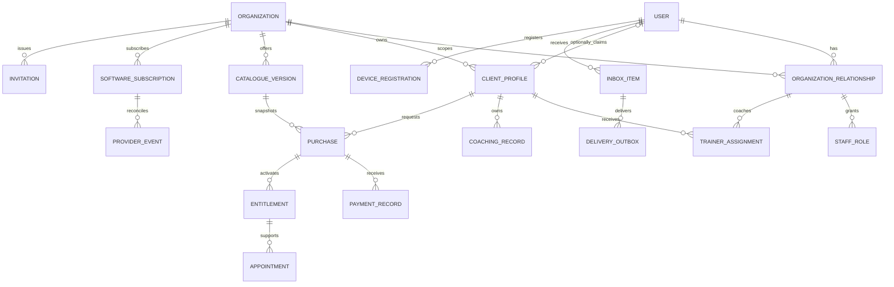

# Gym management — Step 0 review

Prepared 17 October 2026. Status: Step 0 accepted by the user on 17 October 2026. Scope: foundations and representative designs only. No application, database, provider or deployment changes. The implementation plan remains the source of agreed scope; later-step decisions explicitly listed as open remain unresolved.

## Current evidence

Inspected root `AGENTS.md`, `vectra-ui/src/App.tsx`, `mobility-ai-service/app.py`, `services/auth_service.py`, and root `database/migrations/V1__baseline.sql`; V2 is the highest migration currently present. Authentication still requires a coach profile; client selection is stored without business scoping. Clients belong to coaches, and `associated_gym` is descriptive text. Analysis records can have no client; legacy jobs have no ownership column. These require an explicit migration exception queue. No live database or provider was inspected.

The supplied images inform desktop sidebar, summary cards, split client list/detail and activity hierarchy. Blue accents are replaced by the agreed palette. The older WhatsApp-only proposal does not define this release's identity or access model.

## Accepted foundational direction

| ID | Recommendation | Decision gate |
| --- | --- | --- |
| F1 | One personal email/password account, verified for new onboarding; phone is contact information initially. No phone OTP in initial scope. Existing users retain access during a separately reviewed verification transition. | Before Steps 2–3 |
| F2 | Owner and admin share daily gym operations. Only owners manage admins, payment destinations, software billing and ownership transfer. Transfer requires recipient acceptance and fresh authentication. Never remove/demote the last active owner. | Before Step 2 |
| F3 | Each existing coach maps deterministically to one independent coaching organization and becomes its owner. Preserve IDs/history; do not infer gyms from `associated_gym` or merge people by name. Existing clients remain unclaimed until a verified invitation links an account. | Before Step 1 |
| F4 | Migration alone must not trigger a subscription lockout. Preserve existing access using an explicit legacy-transition state; decide price, notice period and transition end before Step 4. This is not permanent free access. | Shape before Step 1; commercial terms before Step 4 |
| F5 | Owner/admin may coach through the same navigation. Assignments express who delivers coaching; management access does not require a second trainer login. A member relationship survives removal of a staff role. | Before Steps 1–2 |

The user accepted the foundational recommendations F1–F5 and representative screen direction: “This looks good, matches what I want.” The permission matrix and conceptual entity model form the reviewed Step 0 baseline. Detailed API contracts remain proposals for their owning implementation steps; illustrative prices and capacity examples are not approved commercial or counting rules.

## Proposed permission matrix

All permissions require an active business relationship and server-side resource ownership checks. A person's permissions are the union of their current roles within the selected organization; roles never leak across organizations. Member self-access is separate from staff permissions. Subscription restrictions remain a later decision.

| Capability | Owner | Admin | PT | Member / online client |
| --- | --- | --- | --- | --- |
| View business members and operational records | All | All | Assigned clients only | Own record only |
| Edit/publish coaching plans, goals and analysis feedback | All business clients | All business clients | Active assigned clients | No |
| Read published coaching material | All | All | Assigned clients | Own published material |
| Read drafts/private coaching notes | Business staff scope | Business staff scope | Assigned clients | Never |
| Submit progress and view appointments | All permitted clients | All permitted clients | Assigned clients | Own only |
| Manage gym/PT catalogue and assignments | Yes | Yes | No | No |
| Confirm UPI/cash and activate purchases | Yes | Yes | No | No; submit own evidence only |
| Record external refunds and payment corrections | Yes, audited | Yes, audited | No | View own outcomes |
| Reports and business-wide collections | Yes | Yes | No | Own purchase history only |
| Invite/deactivate trainers | Yes | Yes | No | No |
| Add/remove admins; ownership transfer | Yes, last-owner guard | No | No | No |
| Change payment destination; software billing | Yes | No | No | No |
| Target business announcements | Yes | Yes | No bulk announcements initially | Read own inbox |
| Change personal credentials | Own account | Own account | Own account | Own account |

Staff-private material is proposed as available to authorized business coaching staff, not author-only. Confirm if private notes require narrower visibility. Removed PTs immediately lose assigned-client access, including downloads, background result access and already-issued sessions; historical records remain for authorized staff. An owner who coaches counts toward the gym capacity rule once that rule is approved.

## Conceptual entity model

`CLIENT_PROFILE` is the organization-scoped person receiving services, including gym members and independent coaching clients; its login link is nullable. A staff relationship does not itself confer a membership. Gym membership periods and PT entitlements are distinct entitlement types with distinct eligibility checks. `COACHING_RECORD` groups existing goals, plans, photos, drafts and analyses conceptually, not as a proposed replacement table. Provider events refer only to Vectra software billing; gym payment records refer to manually checked receipt.

Every business record needs organization scoping, including invitations, notifications, purchases, media and jobs. Cross-record references must constrain the same organization. Maintain a unique organization/user relationship and an explicit membership/client association; avoid duplicate same-user profiles within one business after verified claim. Assignment references a trainer relationship with active permissions, not just a user ID.

Step 1 introduces only organization/relationship/role structures and necessary scoping/legacy mapping, not all diagram entities. Preserve old ownership columns during expand/backfill/switch. Record a unique source-coach-to-organization mapping so backfills can be retried. Resolve ownerless jobs/media through evidence or restricted quarantine; never assign them to a guessed gym. Reconcile row counts, foreign keys and media associations before switching reads. Rehearse on an isolated database copy and retain restore/rollback compatibility.

## API outline for subsequent steps

Paths and contracts are proposals, not endpoints implemented by Step 0. `org` below means `/organizations/{organization_id}`. Authentication is global; business authorization is checked on every request and worker operation.

| Step | Proposed surface | Contract boundary |
| --- | --- | --- |
| 2 | `GET /auth/me`, `GET /me/organizations`, `GET org/capabilities` | Account independent of coach profile; capabilities help display UI but never replace backend authorization. |
| 2 | `GET/POST org/clients`; existing goals/plans/photos/drafts/analyses under scoped routes | Migrate existing routes with compatibility checks; protect all direct-ID/PDF/media routes as well. |
| 3 | `POST org/invitations`, `POST /invitations/{token}/accept`; verification/recovery routes | Expiring single-use tokens; verified recipient; generic recovery responses. |
| 4 | `POST org/software-subscription`, cancellation operation; provider webhook | Server verifies paid amount, business, plan, signature and event identity; mandate alone is insufficient. |
| 5 | `GET /public/gyms/{slug}`, `POST org/purchases` | Public allowlist only; backend snapshots price, terms and payment destination. |
| 6 | `POST org/purchases/{id}/payment-submissions`, `POST org/purchases/{id}/confirm-and-activate` | Owner/admin only for confirmation, actual receipt required; atomic activation and durable outbox. |
| 6 | Purchase correction/rejection and refund-record operations | Append audit events; do not delete payment history or imply a bank refund. |
| 7 | `GET org/trainers/availability`, PT purchase and appointment operations | Availability is advisory; transaction rechecks eligibility, capacity and overlap. |
| 8 | `GET org/reports/collections`, `GET org/inbox`, notification/read operations | Confirmed collections separate from pending submissions; recipient authorization. |
| 9 | `POST /me/devices`, revoke device operation | Device belongs to authenticated person; deep links recheck current organization permission. |

Proposed common conventions: integer paise and explicit INR currency; UTC event timestamps, India-local display, calendar dates for membership coverage. Immutable purchase snapshots. Idempotency keys for purchase creation and consequential commands. Reject conflicting retries; enforce database uniqueness/locking as well. Return field errors for invalid input, 401 for no valid session, 403 for denied operation, 404 for inaccessible resource IDs, and 409 for stale state/capacity/duplicate conflicts. Cursor pagination on lists. No tokens in query-string download links in the target design; review a protected download or narrowly scoped short-lived URL approach in Step 2.

## Later decisions remain open

| Decision | Candidate direction for discussion, not an approved rule | Required before |
| --- | --- | --- |
| Software commercial terms | Separate gym/coach plans; prices, intervals, grace, cancellation, refund and restricted-access rules still needed. | 4 |
| Membership calendar | Propose start-inclusive/end-exclusive periods; clamp anniversary to valid month-end, show last covered date. Active renewal extends coverage; expired renewal begins on activation or explicit future start, never silently backdated. Decide anchor behavior across successive month-end renewals. | 6 |
| Payment exceptions | Correction queue for wrong amount/proof, reused reference, old destination and external refund. Staff record actual receipt; received money cannot disappear through purchase cancellation. | 6 |
| PT capacity | Propose distinct assigned clients with usable PT entitlement, per trainer per gym, including per-session balances and owner-coaches. Multiple packages for one client count once. Decide outstanding-session expiry, reservations and temporary reassignment overlap. No gym limit for online coaches by default. | 7 |
| Verification delay | Decide reservation duration before taking PT payments. Expired reservations require recheck; paid-but-unfulfillable cases go to reassignment, explicit alternative or external refund resolution. | 7 |
| PT service terms | Session length, duration-package inclusions, booking limits, notice period, no-shows, consumption and reassignment consent remain open. | 7 |
| Historical access | Decide member access to published plans after membership/PT/software expiry; do not couple account existence to entitlement. | 8 |
| Mobile delivery | Proposed Android/iOS push plus web inbox; runtime/provider, browser push and mobile purchase entry points reviewed with current documentation in Step 9. | 9 |

## Representative design review

All names, counts, dates, packages and prices in the designs are fictional review fixtures, not commercial decisions. Four views are supplied in the accompanying interactive preview:

1. Owner dashboard: integrated operations/coaching navigation, confirmed collections separate from pending verification, expiry attention and own coaching work. No owner/PT mode switch and no business selector for a single relationship.
2. Trainer clients: scoped client list with selected-client detail, published plan and next coaching action; no business finances or payment confirmation. The 9/10 indicator illustrates the proposed count, not a settled counting rule.
3. Member home: mobile layout with explicit paid-through date, published workout, appointment and PT eligibility explanation. No staff navigation or private notes.
4. Public QR onboarding: mobile web gym identity, account entry, plan choice and manual payment-verification state. Registration QR leads here; payment instructions are a later, separately labelled step. No installation prompt. Same-phone payment provides copyable details. No real or scannable payment QR is generated in this design.

## Shared design system

| Token | Proposal |
| --- | --- |
| Brand | Electric lime `#C5F135`; charcoal `#171A16`; off-white `#F6F7F2`; white cards. Fixed light workspace for this review. |
| Text | Charcoal primary; `#596052` secondary; lime never used as small text on light surfaces. |
| Type | System sans-serif initially, no font dependency; web 30–32px page heading, 18–20px section heading, 14–16px body; mobile 26–28px heading and 16px editable fields. |
| Spacing | 4px base, 8/12/16/24/32 scale; 24px desktop workspace padding, 16px mobile; 12px card radius. |
| Controls | 44px minimum touch targets, visible labels, text with icons, charcoal-on-lime primary buttons; bordered secondary buttons. |
| Focus | 2px charcoal outline with offset on light/lime; lime outline in dark navigation. Focus remains visible on all interactive controls. |
| Status | `#166534` on `#DCFCE7` for active; `#854D0E` on `#FEF3C7` for pending; `#991B1B` on `#FEE2E2` for errors. Always pair color with status text. |
| Form boundaries | `#7A8272` on white; decorative dividers may use `#E0E4DA`. Errors include field text and recovery, preserve entered data. |
| Responsive layout | Desktop sidebar and split client detail; narrow screens stack detail and condense navigation. Native mobile uses bottom destinations and safe-area-aware layouts when implemented. Business selector only for multiple relationships. |

Required state inventory: loading with meaningful label; empty with next action; network failure with retry; denied/revoked access without stale private data; disabled PT purchase with required coverage date; pending payment with no active entitlement; corrected/rejected evidence with resubmission; verification conflict with refresh; confirmed activation only after server success. Buttons disable during submission and preserve input on failure. Dynamic status is announced politely; errors use alerts. Reduced motion respected. The mock is a design preview, not a full demonstration of these states.

## Verification and review checkpoint

Verify document coverage against Step 0, calculate contrast from sRGB values, check mock script syntax and inspect representative wide/narrow layouts. Record actual outcomes below. Application lint/build and backend tests are not a validation of this documentation-only step; application source remains unchanged. No claims about real device accessibility, payment, email, push or migrations follow from mock verification.

Step 0 review completed: the user accepted the foundations and four screen directions. The user subsequently authorized Step 1; its first additive-schema slice is now prepared and verified for review in [the Step 1 schema review](GYM_MANAGEMENT_STEP_1_SCHEMA_REVIEW.md). Later commercial, calendar, PT and delivery decisions remain open as documented above.

### Checks performed

- Read the repository instructions and compared this packet with all Step 0 deliverables. Existing implementation plan left unchanged.
- Mock JavaScript passed `node --check`; literal markup checks passed.
- Browser inspection covered all four screens, selected-client switching, and onboarding through package selection, payment instructions and awaiting-verification state. Inspected desktop rendering and the owner layout at a 320px frame width. Corrected low-contrast preview labelling against a dark host background.
- Calculated contrast ratios: charcoal/lime 13.39:1; charcoal/off-white 16.31:1; secondary text/white 6.52:1; active status 6.49:1; pending status 6.15:1; error status 6.80:1; form border/white 3.99:1. Lime/white is only 1.31:1 and is not a text pairing.
- These are selected design checks, not a full accessibility audit. Complete keyboard/focus, all-width, native mobile and state coverage remain implementation checks. Narrow mock navigation is condensed for composition review; the production mobile menu must expose all permitted destinations.
- No application source changed; no application build, backend tests, database migration, or provider integration was run.

Preview source for this chat: `/Users/padmakumar0930/.codex/visualizations/2026/10/17/01a148b4-9c0b-7f30-b6dc-ec7c3957ca7c/vectra-step-zero.html`. It is a local design preview outside application source, with no persistence or network actions.
